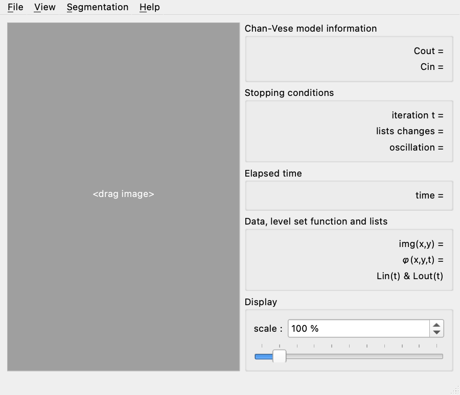
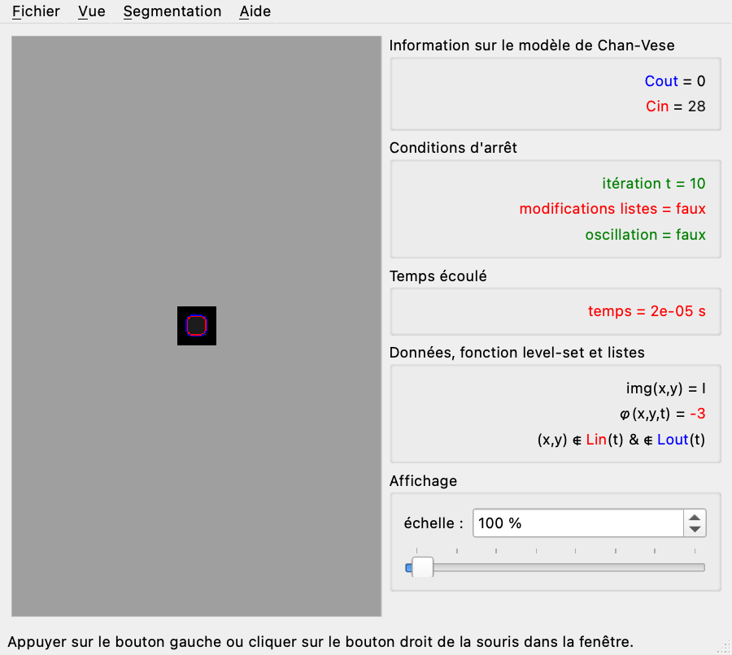

# Ofeli

Ofeli (Open, Fast and Efficient Level set Implementation) is a Qt desktop application for image filtering and active-contour segmentation.

## Requirements

- CMake 3.16 or newer
- Qt 6.11.1 with Widgets, PrintSupport, and LinguistTools
- A C++17 compiler

The project is configured for Linux, macOS, and Windows. Linux builds and the core smoke test run in CI.

## Build and test

~~~sh
cmake -S . -B build -DCMAKE_BUILD_TYPE=Release
cmake --build build --parallel
ctest --test-dir build --output-on-failure
~~~

If Qt is installed outside CMake's default search path, add `-DCMAKE_PREFIX_PATH=/path/to/Qt/6.11.1` to the configure command.

The French translation is compiled from Ofeli_fr.ts during the build; no generated .qm file is required in the source tree.

## Qt Creator

Open the repository's `CMakeLists.txt` in Qt Creator and select a Qt 6.11.1 CMake kit. Configure a fresh build directory, then build the `Ofeli` target. On an Apple Silicon Homebrew installation, set CMake's `CMAKE_PREFIX_PATH` to `/opt/homebrew/opt/qt` if Qt Creator does not find Qt automatically.

If Qt Creator reports `No rule to make target 'all'`, it is using an old qmake/Makefile build configuration. Remove that build configuration in Qt Creator and re-open `CMakeLists.txt`; do not open the old `.pro` project.

## Release smoke checklist

- Launch the app and restore/save window settings.
- Open grayscale and RGB images; run Chan-Vese and geodesic segmentation.
- Apply Gaussian, salt-and-pepper, and speckle noise.
- Switch English/French and restart; open the print dialog and preview/output.
- Check 100%, 150%, and 175% display scaling.

## License

The source files carry CeCILL v2 notices, and license.txt / licence.txt contain the English and French CeCILL license text. The top-level LICENSE file currently contains GPLv3 text and must be reconciled with the copyright holder before a release license is declared.
